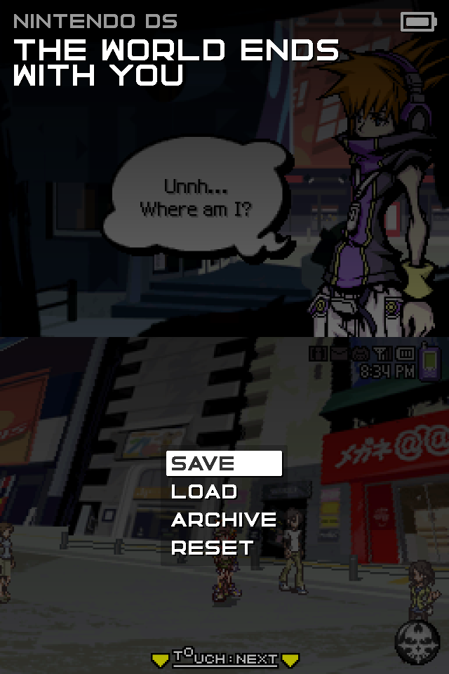
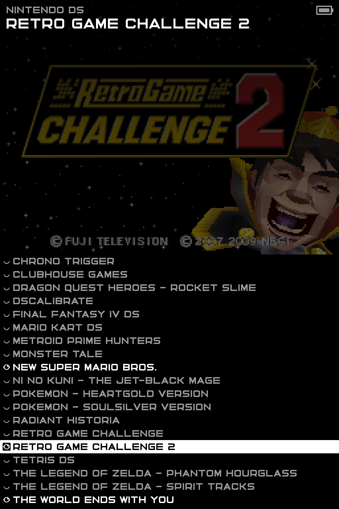
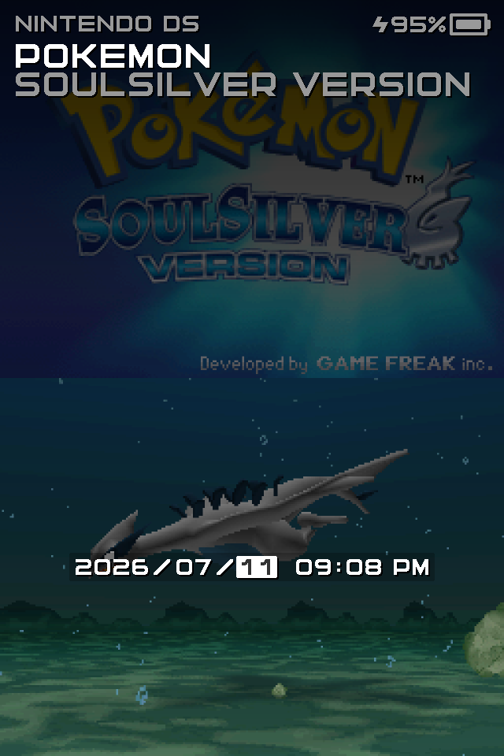
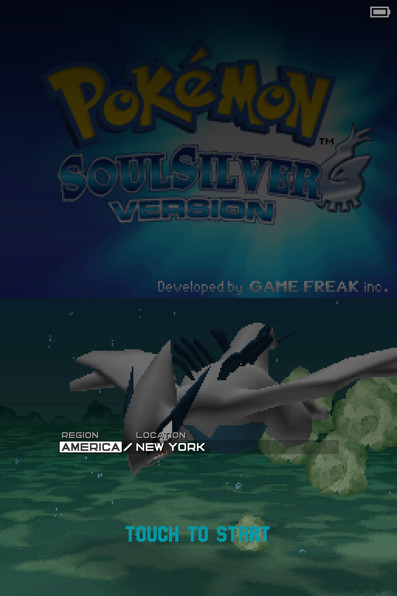

# DEDICATED OS

DEDICATED OS is a cluster of hyper-focused, single-system launchers for specific devices. This version is for playing Nintendo DS on the RG DS Plus. It is also available on the [MagicX Zero40](https://github.com/dedicated-os/dedicated-zero40).

This is what it looks like:

  

That's it. You can [grab the latest version here](https://github.com/dedicated-os/dedicated-rgds/releases).

## Features

- no options
- single save state per game
- fast game switcher
- drastic for emulation
- silent fast-forward
- datetime and timezone switcher
- archive for hiding completed or unstarted games
- auto-save on poweroff and when switching games
- auto-resume on boot and when switching games
- faux-sleep with auto-poweroff

## Usage

L2 simulates closing the lid. R2 simulates the mic.

Press the Anbernic/MENU button to open the in-game menu where you can save, load, and reset the current game or switch to and load or reset a different game. 

Press MENU again to open the system menu where you can manage your archive and set the date, time, and timezone.

  

## Original RG DS Support

The original RG DS is unsupported, its 640x480 screens were a mistake and I won't dignify it with a release.