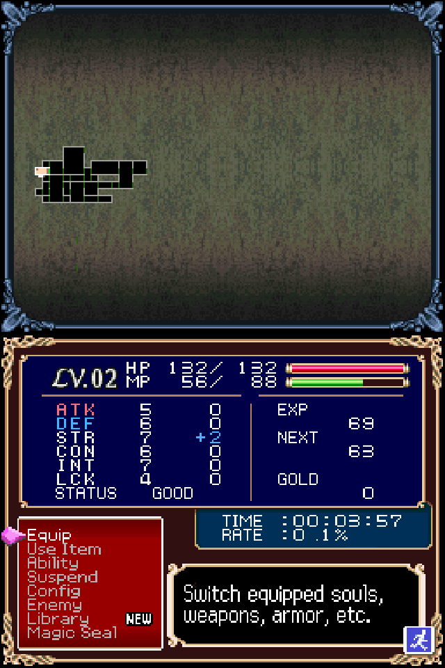
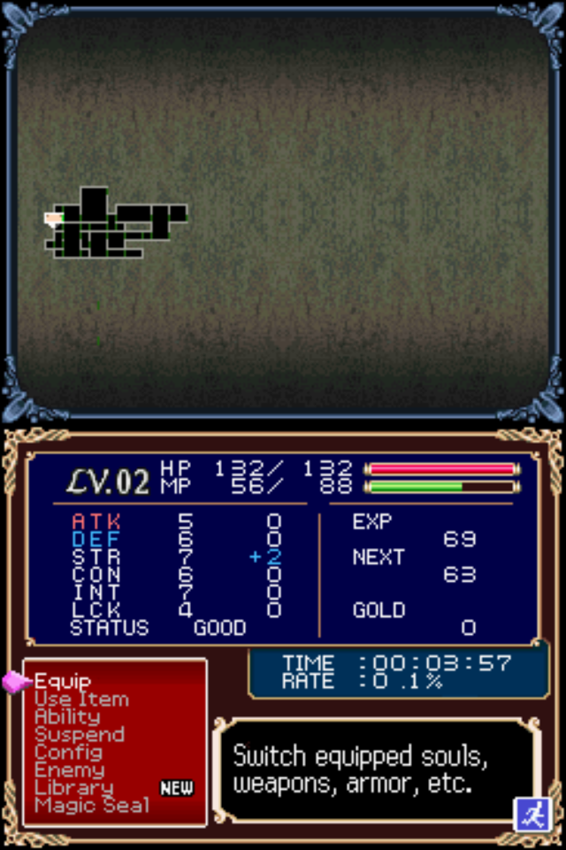
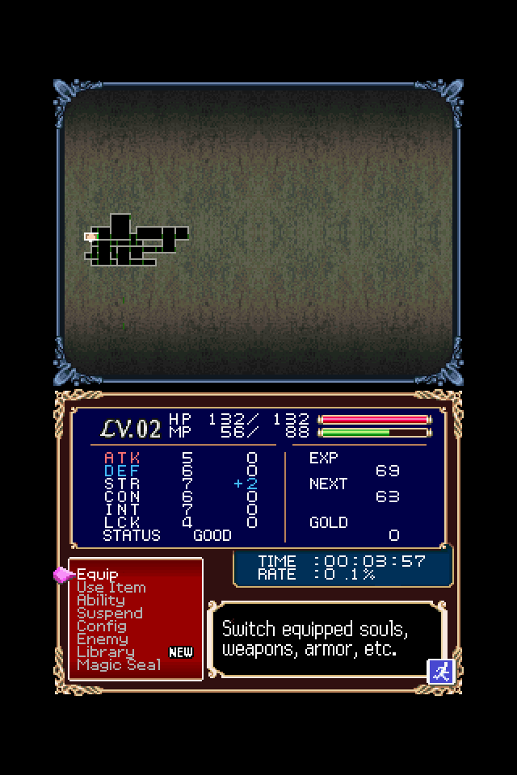

# DEDICATED OS

DEDICATED OS is a cluster of hyper-focused, single-system launchers for specific devices. This version is for playing Nintendo DS on the RG DS.

This is what it looks like:

  

That's it. You can [grab the latest version here](https://github.com/dedicated-os/dedicated-zero40/releases).

## Features

- no options
- datetime switcher
- single save state
- fast game switcher
- drastic for emulation
- fast-forward
- archive for hiding completed or unstarted games
- auto-save on poweroff, when switching games
- auto-resume on boot
- faux-sleep with auto-poweroff

## Presentation 

DEDICATED OS offers 4 scaling modes: nearest neighbor, sharp (default), linear, and integer. Anbernic chose the wrong screen for this device. The default is the best of only bad options.

   

Toggle integer scale with `MENU + L2`. Cycle through sharpness with `MENU + R2`.

Pressing `SELECT` in the menu brings up the datetime switcher.

 

After changing the datetime you must save in-game then reset from the menu for the game to notice the change.